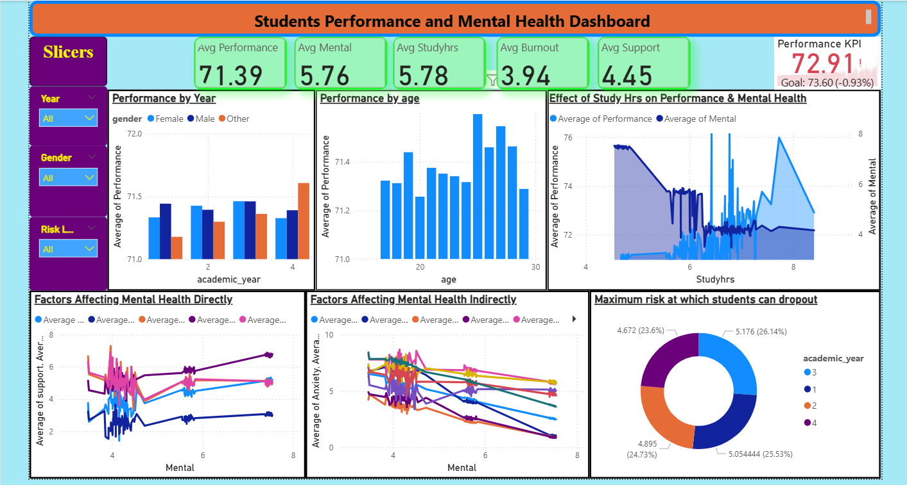

# Student Performance and Mental Health Analysis

This project investigates student academic performance, mental-health indicators, burnout, study habits and dropout risk. It demonstrates an end-to-end analytical workflow, from data inspection and preparation in SQL Server to exploratory analysis and visual communication in Power BI. The original data is obtained from Kaggle.com and it contains 20 columns and 1M rows.

## 1. Project background

Academic performance is influenced by many factors, and understanding the relationships between study habits, mental well-being and academic outcomes can help inform student-support decisions.

This project explores the available student data to identify patterns and relationships among these indicators.

**Main analytical question:**

> What patterns and relationships exist between students' academic performance, study habits, mental-health indicators, burnout and dropout risk?


## 2. Project objectives

- Inspect the dataset and understand its structure.
- Identify missing values, data-type issues and possible duplicate records.
- Clean and prepare data for analysis.
- Calculate descriptive statistics and examine distributions.
- Compare student indicators across relevant academic and demographic groups.
- Build a Power BI dashboard to communicate key indicators and patterns.
- Investigate relationships exhibited.
- Identify areas that may deserve further investigation.

## 3. Tools and technologies

| Tool | Application |
|---|---|
| SQL Server | Data inspection, cleaning, transformation and exploratory analysis |
| Power BI | KPI reporting, interactive visualisation and dashboard development |
| CSV | Dataset storage and data exchange |

## 4. Data and variables

The original source file for this project is named `student_mental_health_burnout_1M.csv`, and was downloaded from Kaggle.com datasets.

Click the following link to download the data.

https://drive.google.com/file/d/1ccRxOzLoP_vo2Q9xK7K2-SBKOfkLgvWQ/view?usp=sharing

The data has 20 columns and one million rows as shown below from SQL Results/Messages Pane.

<table>
  <tr>
    <th>Dataset Columns from SQL</th>
    <th>Dataset Rows from SQL</th>
  </tr>
  <tr>
    <td>
      
    </td>
    <td>
      
    </td>
  </tr>
</table>

The analysis focuses on the above indicators.

## 5. Analytical workflow

### 5.1 — Data inspection

The first stage involves examining the source table and its structure. Opening the file in excel takes some time and scrolling down the multi-displayed numbers feels mentally exhausting. This necessitates the importation of the csv file into SQL for easy and efficient data inspection.
Upon importation process, it displays the columns data types as shown below.

The SQL analysis includes:
- Checking the number of records (20 Columns and 1 M rows).
- Inspecting columns and data types.
- Identifying missing or blank values.
- Checking for possible duplicate records.
- Reviewing values that may require conversion or validation.

**Why this matters:** Data quality issues can affect calculations and lead to misleading conclusions if they are not identified before analysis.

### 5.2 — Data cleaning and preparation

SQL Server was used to prepare the data for analysis.

The scripts demonstrate:
- Converting fields to appropriate data types.
- Cleaning text values.
- Handling numeric conversion checks.
- Examining missing values.
- Checking for duplicate records.
- Preparing cleaned and aggregated tables.

**Important:** A duplicate check does not automatically remove duplicates, and identifying missing values does not by itself mean those values have been treated. These decisions should be documented separately.

### 5.3 — Exploratory data analysis (EDA)

The next stage uses descriptive statistics and grouped summaries to explore the data.

The SQL scripts demonstrate:
- Counts and frequency summaries.
- Mean, median and standard deviation.
- Variance and other descriptive measures.
- Percentiles and distribution summaries.
- Comparisons across selected demographic and academic groups.

**Why this matters:** EDA helps reveal the distribution of variables, identify unusual values and guide the questions explored in the dashboard.

### 5.4 — Power BI dashboard

Power BI was used to present selected indicators and comparisons in a visual format.

The dashboard includes:
- KPI cards for average performance, mental health, study hours, burnout and support.
- Academic performance comparisons by academic year and age.
- Comparisons involving study hours, performance and mental-health indicators.
- Visual exploration of mental-health-related factors.
- Dropout-risk breakdowns by academic year.

### Dashboard preview



## 6. Dashboard observations

The supplied dashboard screenshot displays the following headline values:

| Indicator | Displayed value |
|---|---:|
| Average performance | 71.39 |
| Average mental health | 5.76 |
| Average study hours | 5.78 |
| Average burnout | 3.94 |
| Average support | 4.45 |
| Performance KPI | 72.91 |
| Performance KPI goal | 73.60 |

The displayed performance KPI is 0.69 points below its stated goal.

These figures provide a high-level summary of the dashboard. They should be interpreted in the context of the variable definitions, measurement scales and filters applied in Power BI.

The visual comparisons can help generate further questions, such as whether study hours and performance vary together, or whether dropout-risk categories differ across academic years. The chart patterns should be examined before making specific claims about these relationships.

**Results validation:** The values above are transcribed from the supplied dashboard screenshot. Refresh the Power BI report against the intended source data and verify its measures before treating them as final results.

## 7. Key analytical questions for further investigation

The project provides a foundation for investigating questions such as:

1. Is there an observable relationship between study hours and academic performance?
2. How do mental-health and burnout indicators vary across academic years?
3. Do academic performance patterns differ across age groups?
4. How is dropout risk distributed across academic years?
5. How do support indicators vary alongside mental-health and performance measures?

These are questions for analysis, not assumed findings. Further statistical testing would be needed to assess the strength and uncertainty of observed relationships.

## 8. Repository structure

```text
student-performance-mental-health-analysis/
│
├── data/
│   ├── sample_student_mental_health.csv
│   └── README.md
│
├── docs/
│   └── methodology.md
│
├── images/
│   └── dashboard_preview.png
│
├── powerbi/
│   └── student_mental_health_dashboard.pbix
│
├── sql/
│   ├── 01_initial_exploration_and_cleaning.sql
│   ├── 02_cleaned_data_eda.sql
│   └── 03_reduced_data_analysis.sql
│
└── README.md
```

## 9. How to reproduce the analysis

1. Obtain the original dataset from its lawful source and check its licence and redistribution conditions.
2. Import the dataset into SQL Server.
3. Create or select the `StudentsDB` database.
4. Check the database and table names used in the SQL scripts.
5. Run the SQL scripts in the recommended order.
6. Resolve any table-name differences between the scripts and your SQL Server environment.
7. Open the Power BI file and update its data-source connection to your SQL Server instance.
8. Refresh the report and validate the dashboard measures.

**Recommended SQL execution order:**

1. `01_initial_exploration_and_cleaning.sql`
2. `02_cleaned_data_eda.sql`
3. `03_reduced_data_analysis.sql`

The scripts contain references to more than one reduced-table name. Confirm the table created in your environment and align the references before running the final script.

## 10. Limitations and responsible interpretation

- The repository contains a 5,000-row sample, not the original approximately 198 MB dataset.
- The dataset source, collection methodology and licence should be documented before the analysis is used for formal research.
- The dashboard figures should be revalidated against the intended data source.
- Missing-value and duplicate checks do not automatically perform treatment or deletion.
- Aggregated results can conceal variation between individual records.
- Associations do not establish causation.
- Mental-health indicators are not clinical diagnoses. Results should be communicated responsibly and without identifying individuals.

## 11. Skills demonstrated

- Data inspection and quality assessment
- SQL data cleaning and transformation
- Descriptive statistics and exploratory data analysis
- Data aggregation and analytical querying
- Power BI dashboard development
- KPI reporting and data visualisation
- Communicating analytical results and limitations

## 12. Future improvements

- Add a complete data dictionary with variable definitions, units and valid ranges.
- Document the original dataset source and licence.
- Add data validation queries for out-of-range values and failed conversions.
- Validate dashboard measures against SQL outputs.
- Add statistical tests to investigate selected relationships.
- Consider an appropriate regression model if the research objective is extended to prediction.
- Improve chart annotations to make the findings easier to interpret.

## Author

**K-lv-n**  
Data Analytics Portfolio Project

**Technologies:** SQL Server | Power BI | Data Cleaning | Exploratory Data Analysis | Data Visualisation
